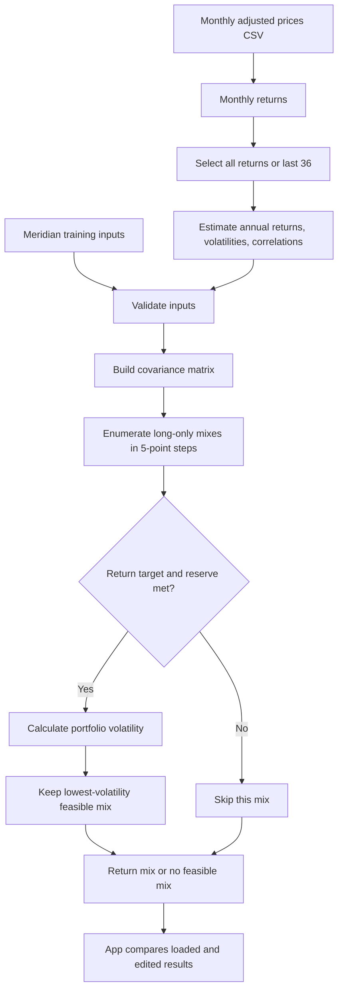

# Lab 15 — Portfolio Stability Decision

Prepared with AI assistance. Computational work and app tests were completed; review the explanation
and proposed decision before submission. 
## Define: client and decision

Client: Northbridge Community Scholarship Fund, the fictional $10 million, ten-year client in
[my Lab 13 draft](https://github.com/alexalex123-alex/AAPL--research/blob/main/lab13.md#project-2-draft-client-mandate).
Question: which feasible 5-point allocation has the lowest estimated volatility, and how stable is it?

The student confirmed a 5.5% nominal annual return target: CPI estimate 2.5% plus 3% real return.
The reserve constraint is initially 3% ($300,000 for four $75,000 quarterly distributions), with
only BIL eligible under the course's cash-proxy convention. Recompute the reserve percentage as
portfolio value changes. This reserve proxy is a classroom assumption, not a literal Treasury holding.

Holdings are long-only and fully funded. Diversified funds are exempt from the mandate's company
concentration cap. For this exercise, exchange-traded fund shares are treated as liquid within five
business days under normal markets. The derivatives prohibition is applied at the portfolio level;
no separate derivatives or margin positions are added. Underlying fund use of derivatives is not
independently certified. These interpretations need client agreement before real implementation.

## Represent: funds and sourced prices

| Ticker | Fund | Role | Reserve eligible? |
|---|---|---|---|
| BIL | SPDR Bloomberg 1–3 Month T-Bill ETF | Short Treasury bills / cash proxy | Yes |
| IEF | iShares 7–10 Year Treasury Bond ETF | Government bonds | No |
| LQD | iShares iBoxx $ Investment Grade Corporate Bond ETF | Corporate investment-grade bonds | No |
| VT | Vanguard Total World Stock ETF | Global equity | No |

All prices were downloaded **November 1, 2026** from Yahoo Finance. Source requests, one per ticker:

- [BIL adjusted-price feed](https://query1.finance.yahoo.com/v8/finance/chart/BIL?period1=1633046400&period2=1793491200&interval=1d)
- [IEF adjusted-price feed](https://query1.finance.yahoo.com/v8/finance/chart/IEF?period1=1633046400&period2=1793491200&interval=1d)
- [LQD adjusted-price feed](https://query1.finance.yahoo.com/v8/finance/chart/LQD?period1=1633046400&period2=1793491200&interval=1d)
- [VT adjusted-price feed](https://query1.finance.yahoo.com/v8/finance/chart/VT?period1=1633046400&period2=1793491200&interval=1d)

`prices.csv` contains the final available daily **Adj Close** in each month, labelled by calendar
month-end. A weekend label does not imply trading on that date. There are 61 shared month-end
observations, October 2021–October 2026, giving 60 returns for November 2021–October 2026.
The shorter window uses 36 returns for November 2023–October 2026, not just 36 prices.
No missing months were filled and no prices were invented. Vendor-adjusted history can be revised.

Return estimates are arithmetic monthly means multiplied by 12; annualized volatilities use sample
monthly standard deviation multiplied by the square root of 12. Correlations use the same months.
These are historical **estimates**, not forecasts or guaranteed compound growth rates. Adjusted prices
reflect distributions and fund expenses through the price series; no second expense-ratio deduction
is made. Advisory fees, trading costs and taxes are not separately modeled, so meeting the proxy
target does not establish the mandate's fully net-of-all-costs objective.

| Ticker | 60-month return estimate | 60-month volatility | 36-month return estimate | 36-month volatility |
|---|---:|---:|---:|---:|
| BIL | 3.67% | 0.49% | 4.34% | 0.21% |
| IEF | −1.08% | 7.79% | 4.74% | 6.73% |
| LQD | −0.42% | 9.85% | 6.48% | 7.73% |
| VT | 10.55% | 14.84% | 20.69% | 11.55% |

## Implement: engine and app

`portfolio.py` retains the exact Lab 14 command output. New reusable functions estimate inputs,
enumerate 1,771 four-asset mixes, and select the feasible mix with minimum volatility.
Weights sum to 100%, are nonnegative, and move in 5-percentage-point steps. Consequently, a positive
3% reserve minimum needs at least 5% in eligible assets on this grid. The result minimizes estimated
volatility **within this grid**, not over every possible continuous allocation.

`app.py` imports the engine and contains no second implementation of the portfolio calculations.
Its Meridian mode starts at 6.5%; Northbridge starts at 5.5%; both start with a 3% reserve minimum.
The CSV upload can replace the bundled fund data. Current inputs are compared with the original
loaded inputs on all months, under the same objective and minimum. Return and eligibility edits are
specific to each dataset and window. Changing windows resets to that window's estimates.

This chart was generated with AI. The separate paper-first, no-AI sketch remains a personal activity.

## Validate: Meridian training case

Order is bills / 10-year note / IG bonds / equity; all figures below are computed, not hardcoded.

| Run | Weights (%) | Return | Volatility | Reserve |
|---|---|---:|---:|---:|
| Loaded, 6.5% target | 0 / 20 / 25 / 55 | 6.51% | 9.44% | 20.00% |
| Equity estimate reduced from 8% to 7% | 0 / 10 / 10 / 80 | 6.53% | 12.94% | 10.00% |
| IG–equity correlation changed to 0.50 | 0 / 40 / 0 / 60 | 6.52% | 9.73% | 40.00% |

The equity stress changes the largest weight by **25 percentage points**. The correlation probe was
also tested through the app; original correlations were restored. Independent NumPy calculations
agree with the CSV estimates. The app reports infeasibility without changing the objective.
See `validation.txt` for the automated test record. Testing used Streamlit AppTest, rather than a
manual browser inspection; CSV-backed operation and input parsing were tested, but a manual
file-picker interaction remains part of the user's run-through.

## Evolve: Northbridge results

The 5.5% target and 3% reserve minimum stay fixed throughout.

| Run | BIL / IEF / LQD / VT (%) | Return estimate | Volatility | Reserve |
|---|---|---:|---:|---:|
| All 60 months | 70 / 0 / 0 / 30 | 5.73% | 4.55% | 70.00% |
| Last 36 months | 90 / 0 / 0 / 10 | 5.97% | 1.21% | 90.00% |
| All months; VT return estimate reduced by 1 point | 65 / 0 / 0 / 35 | 5.73% | 5.28% | 65.00% |

Changing the estimation window moves **20 percentage points**, or $2 million at the initial fund size.
The shorter window estimates much stronger equity returns, so less equity is required to reach the
same target. The bond funds are available to the search but receive zero weight in these results.

## Fresh eyes: self-review

AI-assisted self-review targeted VT's return estimate because the growth assumption is uncertain.
The test reduced its all-months estimate from approximately 10.55% to 9.55%, holding volatility,
correlations, objective and reserve minimum fixed. The actual app test produced the allocation above.

Two-sentence response: Lowering VT's return estimate by one percentage point increases its allocation
from 30% to 35%, a largest change of 5 points, because more equity is needed to clear the unchanged
return target. Estimated portfolio volatility rises from 4.55% to 5.28%, showing that a weaker return
assumption can cause this constrained optimizer to recommend more risk.

## Proposed call: pilot

**Pilot the 70% BIL / 30% VT result as a Project 2 research starting point.** A one-point equity
stress moves 5 points, while the window comparison moves 20 points; that sensitivity prevents a
confident adoption based on this sample alone. Reconsider adoption after client-approved forward
return and cost assumptions produce no more than a 10-point allocation change across agreed stress
tests, and a spending simulation confirms reserve maintenance. The 10-point threshold is a proposed
decision rule for review, not a course requirement or a client instruction already obtained.

The 20% annual one-way-turnover limit and annual rebalancing policy are not optimized or verified by
this static app: no existing allocation or trading history was provided. Nor does it simulate ten-year
scholarship payouts, guarantee future liquidity, or resolve the client's choice of downside-risk
versus target-attainment priority. Those remain implementation conditions, not silently passed checks.

## Learn and reflect

Estimation risk is the risk that estimated inputs differ from future outcomes. A return-constrained
optimizer can amplify a small input error because changing a return estimate changes which mixes
are feasible; correlations and volatility estimates also affect their ranking. The Meridian stress
and Northbridge window test demonstrate that an exact calculation can still depend on uncertain inputs.

## Remaining personal actions

## Course references

- [Lab 15 instructions](https://github.com/CinderZhang/FIN43900-Fall2026/blob/main/lessons/week-09/lab-15-portfolio-stability.md)
- [Lab 14 fund preparation](https://github.com/CinderZhang/FIN43900-Fall2026/blob/main/lessons/week-09/lab-14-portfolio-baselines.md)
